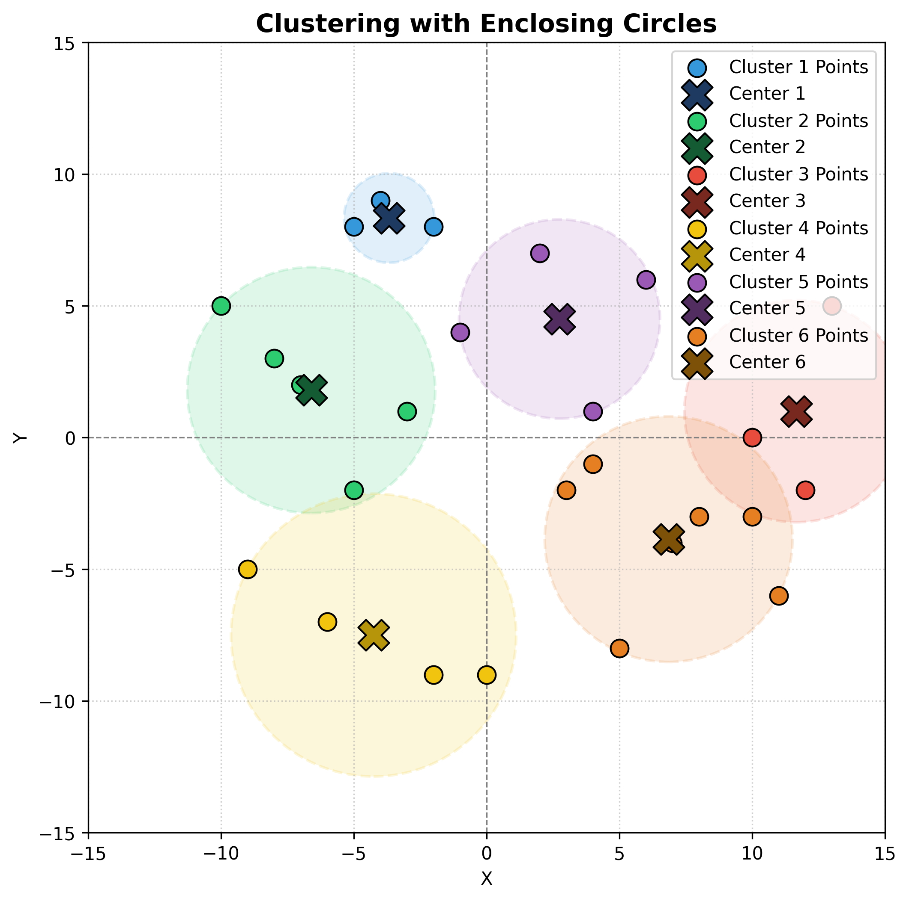

# K-means from scratch

scikit-learn 라이브러리에서 제공하는 k-means model을 python으로 구현해보기 ( AI NO! )

## K-means

k-means 알고리즘은 unsupervised-learning 중 하나이며, 여러개의 점을 임의의 cluster 개수인 k개로 묶어, 모든 점들을 각 cluster의 center $m_i$과의 거리를 비교하여, center $m_{i}^{t+1} = m_{i}^{t}$ 상태가 되면 iteration을 종료하는 알고리즘이다.

흔히 supervised-learning의 k-nn과 햇갈리기 쉬운데, k-nn은 이미 라벨링 된 데이터들 사이, 새로운 데이터가 들어오면, 그 데이터에 한해서만 주변 k개를 탐색 후, 최빈값 label을 label로 삼는다. 그래서 k-nn은 clustering이 아니다.

## Algorithm

k-means에서 cluster 개수인 k값에 따라 optimal cluster을 바로 구하는 것은 NP-hard 문제이다. 현재 내가 구현한 코드에도 이러한 문제를 대변할 수 있는 출력이 있는데, 아래와 같다.

```terminal
❯ python k_means.py
6 cluster에서 불필요한 cluster 1개 제거 후, cluster_circles.png 가 생성되었습니다.
❯ python k_means.py
8 cluster에서 불필요한 cluster 2개 제거 후, cluster_circles.png 가 생성되었습니다.
```

이후 코드 설명에 나올, $cluster_i$가 아무런 point를 가지지 않으면, 불필요한 cluster라고 가정하고, 해당 cluster를 삭제 후, k값을 1 차감했다. 이는 각 center $m_i$ 와 points의 euclidean distance를 구하는 과정에서 `/len(points)` 부분에서 0으로 나누는 error가 생기어, 구현한 부분이었다. 하지만 이런 알고리즘 때문에, `k_size = 8`일때는 `k=6`으로 근사되어, clustering되고, `k_size = 6`이면 `k=5`로 근사되어 clustering된다. 따라서 맨 처음 점들을 어떻게, table에 init하는 지가 제일 중요하며, 이로 인해 optimal로 근사할 수 있냐, 없냐의 차이로 이어지는 것 같다.

scikit-learn의 라이브러리는 이러한 clustering에서 lloyd algorithm을 기본적으로 사용하며, 필요에 따라 연산량은 적지만, 메모리는 많이 잡아먹는 elkan algorithm을 사용한다고 한다. 필자는 lloyd algorithm을 기반으로 구현했다.

### lloyd algorithm

#### 조건

Euclidean plane or non-Euclidean plane 모두 가능

#### iteration logic

1. K개 지점 voronoi diagram calculation
2. voronoi cells 적분 후, center calculation
3. K개 지점은 voronoi cell 중심점으로 이동.

이때 voronoi diagram은 Euclidean plane위에 여러개의 점이 있을때, 각 점까지의 거리가 가장 가까운 평면으로 나누어, 분할한 그림이다.

#### 적분

위의 voronoi diagram을 구현하기 위해서는, 각 분리된 평면을 적분하여, center을 구해야 한다. 이 또한, 쉽게 할 수 있는 것은 아닌데, 여러가지 적분법 중 monte-calro 근사법을 많이 사용한다고 한다. 마치 넓이를 구할 수 없는 도형이 그려진, a4 위에 무작위의 점 N개를 찍어, 알 수 없는 도형안에 찍힌 점의 비율로 넓이를 근사하는 것이다. 이 방법은 RL 에서 각 점을 episode로 해석하여 많이 사용된다. 아래의 수식으로 표현할 수 있다.

$$
\int^{b}_{a} f(x) \approx \frac{b-a}{N} \Sigma^{N}_{i}f(x_i)
$$

하지만 필자는 center들을 하나의 점들과 비교 후, 그 점을 distance가 제일 짧은 center의 index로 이동시키며 구현했다.

## Code

### init

위에서 말했다 싶이, points를 어떻게 table에 넣을 것인지가 제일 중요하다. 필자는 modular방식을 사용하였다. 따라서 필요에 따라 shuffle을 한 후, modular에 넣어도 되는데, 나는 그냥 넣었다.

```py
for i in range(self.k_size):
    start_arr_index = arr_index
    current_cluster_size = self.input_size // self.k_size + (
        1 if i < self.input_size % self.k_size else 0
    )
    arr_index += current_cluster_size

    self.table[i] = points[start_arr_index:arr_index]
```

위에서 `current_cluster_size`를 통해 `start_arr_index:arr_index`만큼 points를 잘라, `table`에 넣어주었다. 사실 `arr_index`를 `k_size`를 통해 배열로 구현 후, `self.table`에 넣는 것은 한번에 처리해도 될 것 같은데, 필요한 분들은 수정해서 더욱 최적화 해도 될 것 같다.

### set_centers

각 table을 기반으로 center들의 점들을 비교하여, 새롭게 center을 잡는 알고리즘이다.

```py
def set_centers(self):
    _centers = [{"x": 0, "y": 0} for _ in range(self.k_size)]
    _table = self.table
    for i, points in enumerate(_table):
        sum_x = 0
        sum_y = 0
        for point in points:
            sum_x += point["x"]
            sum_y += point["y"]

        if len(points) != 0:
            center_x = sum_x / len(points)
            center_y = sum_y / len(points)
            _centers[i] = {"x": center_x, "y": center_y}
```

특히 아랫 부분이 위에 `len(points)`이 0일때 ZeroDivisionError 에러로 인해, 구현한 `k_size` 감소 알고리즘이다.

```py
    for i, points in enumerate(_table):
        if len(points) == 0:
            del _table[i]
            del _centers[i]
            self.k_size -= 1

    self.table = _table
    self.centers = _centers
    return _centers
```

### iteration

```py
def run_iteration(self):
    centers = self.set_centers()

    _table = [[] for _ in range(self.k_size)]
    for points in self.table:
        for point in points:
            distance_for_centers = [0 for _ in range(self.k_size)]
            for i, center in enumerate(centers):
                distance = get_distance(
                    center["x"], center["y"], point["x"], point["y"]
                )
                distance_for_centers[i] = distance
            min_center = distance_for_centers.index(min(distance_for_centers))
            _table[min_center].append(point)

    self.table = _table
    return _table
```

맨 처음에 `set_centers()`를 통해 가지고 있는 points에 대한 center를 재정의 해준 후, 과연 그 center들이 해당 point를 품고 있는게 맞는지에 대해, 검증하는 단계라고 생각해도 된다. 한 point에 대해서 k개의 center들과의 거리를 계산 후, 가장 거리가 짧은 center의 index로 point를 넣어, points를 다시 만들어준다. 이때, 한개의 point도 배당받지 못한 center는 다음 iteration의 `set_centers()`때 제거될 것이다.

### loop

위에 말한 알고리즘 처럼 center이 움직이면서 centers와 tables가 바뀔 텐데, 만약 center들의 움직임이 더이상 안움직인다면, 그때는 그것이 최종해가 될 것이다. 이게 최적해인지는 알 수 없다. 어쨋든 새로 이동된 center와 기존 prev_center와의 거리가 x,y 모두 loss보다 작아졌다면, loop를 마무리 하고, 바뀐 k_size를 알려주도록 했다.

```py
loss = 1e-4
model = Kmean(points, k_size)

    done = False
    prev_center = model.centers
    while not done:
        model.run_iteration()
        done = True

        centers = model.centers
        for k in range(model.k_size):
            distance = get_distance(
                prev_center[k]["x"],
                prev_center[k]["y"],
                centers[k]["x"],
                centers[k]["y"],
            )

            if distance > loss:
                done = False
                break
        prev_center = model.centers
        if done:
            print(
                f"{k_size} cluster에서 불필요한 cluster {k_size - model.k_size}개 제거 후, cluster_circles.png 가 생성되었습니다."
            )
```

이후 matplotlab을 통해 cluster와 center를 시각화 해주었다. 이 부분은 중요하지 않으니, 빠르게 ai툴을 사용해서 구현했다. image화 할때에도, 그려야 하는 cluster의 반지름은 center에 해당된 points들 중 가장 먼 point와의 거리를 반지름으로 잡아서 그렸다.

## Result

26개의 랜덤한 점을 초기 `k=8`로 시작하였는데, iteration과정 중 k가 2 감소하여, 6개의 cluster가 생성되었다.



그래도 점들을 확인해보면, 모두 가장 가까운 center을 기반으로 cluster를 이루고 있는 것을 확인할 수 있다.

## 추가학습

scikit-learn은 k지정시, k를 감소시키지 않고 clustering을 진행한다. 이게 원래 올바른 방법이며, 필자는 1시간동안 빠르게 구현하다 보니, 편법을 사용하여 구현했다. 추후 이 방법을 구현하기 위해 다시 시도해보겠다.

또한 elkan algorithm을 통해서도 clustering을 구현해볼만 하다고 생각한다.

추가로 적절한 k값을 찾는 것은 흔히 elbow method를 통해 시각적으로 판단한다. 하지만 증가하는 k에 비해 loss가 급격히 낮아진다면, 초기에 k를 입력하지 않아도, 해당 점들에 대해 최적의 k값을 구할 수도 있을 것 같다.
